<div align="center">


# Queyou · 雀友计点

**把算点、记分、练习和学习，放在同一个离线牌桌助手里。**

适用于按雀魂规则进行的四人／三人立直麻将 · Android 8.0 及以上 · 作者：HMBlankcat

[下载安装包](https://github.com/HMBlankcat/Queyou/releases/latest) · [1.9.1 发布说明](https://github.com/HMBlankcat/Queyou/releases/tag/v1.9.1) · [界面预览](#界面预览)

</div>

Queyou 为线下日麻设计：不知道番符时直接选牌算分；和朋友打牌时记录每局支付与总分；平时通过何切、听牌和算点练习熟悉判断。教程、牌面、题库与计算均随安装包提供，无需登录，也无需联网。

这是非官方线下辅助工具，不连接雀魂账号或服务器。

## 功能介绍

| 功能 | 可以做什么 |
| --- | --- |
| **看牌算分** | 不用建桌或输入玩家。点选手牌、和了牌、吃碰杠、赤牌与宝牌指示牌，设置荣和／自摸、自风、场风、立直等条件，查看役种、番数、符数、支付金额及加符明细；也支持已知番符速算。 |
| **牌桌记分** | 建立三人或四人玩家名单，记录立直供托、和牌、流局和手动转点；显示每局加减分、当前总分，以及玩家之间的累计支付。结算前可以预览并调整支付金额。 |
| **自动局况** | 根据庄家和牌、子家和牌、荒牌流局或途中流局，自动调整庄家、本场、局数与场风；可手动校正，撤销结算时同步恢复局况。 |
| **牌效分析** | 13 张分析向听与进张，14 张比较舍牌；支持副露、宝牌和已见牌。按向听与有效进张给出建议，可继续计算好形率与 EV。 |
| **何切练习** | 内置 **720 道**经校验的牌效题，四麻与三麻各 360 道；可筛选向听阶段、按题号或随机作答，接受等价的最优舍牌。 |
| **清一色听牌训练** | 随机生成合法的 13 张清一色听牌，提供 2–3 面、4–6 面、7–9 面难度；多选所有等待牌，答后查看拆牌解析。 |
| **点数与符数练习** | 给出手牌、和了牌、副露与场况，由你计算支付或符数；支持四麻／三麻、基础／进阶，答后显示解析，并分别统计正确率与连对。 |
| **役种与点数速查** | 役种配有完整和牌示例，标记和了牌与副露，支持搜索、筛选和带入算点；役种表与四麻／三麻支付点数表可单独查看。 |
| **学习专栏** | 入门 **14 章**、进阶 **23 节**、**74 道**课内自测、**60 条**术语，配合练习册、参考答案和技术补充；支持全文搜索、目录跳转、图片放大、字号调整、阅读进度与位置记忆。另有简明新手指南。 |
| **外观与常用设置** | 青竹、暖纸、夜墨、晴空、樱霞与跟随系统主题；预设背景、自定义颜色或图片、背景模糊与透明度、卡片透明度；三种牌面、手牌大小、辅助牌名、界面字号、App 亮度、常亮、振动、减少动效及启动页设置。 |
| **本地数据管理** | 导出 CSV、JSON 备份与恢复、撤销上一笔；可删除单桌对局、清除历史对局或清空全部本地数据。外观方案可独立导入导出。 |
| **随机骰子** | 随时掷两颗独立的 1–6 点骰子，显示骰面及总点数，不影响对局记录。 |

## 界面预览

以下为 1.9.1 的实际运行界面，使用示例手牌和演示玩家数据。点击图片可查看大图。

<table>
  <tr>
    <th>选牌算分</th><th>番符与支付明细</th><th>我的牌桌</th>
  </tr>
  <tr>
    <td>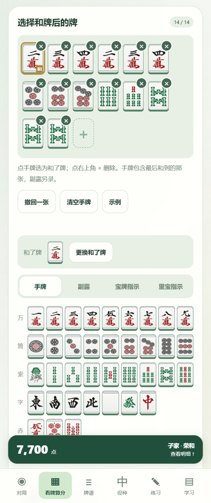</td>
    <td>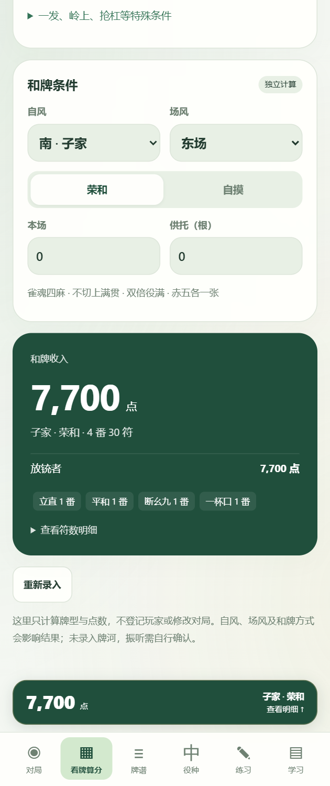</td>
    <td>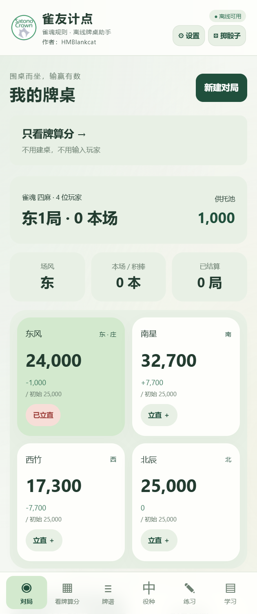</td>
  </tr>
  <tr>
    <th>每局记分与玩家往来</th><th>舍牌与进张分析</th><th>役种牌型示例</th>
  </tr>
  <tr>
    <td>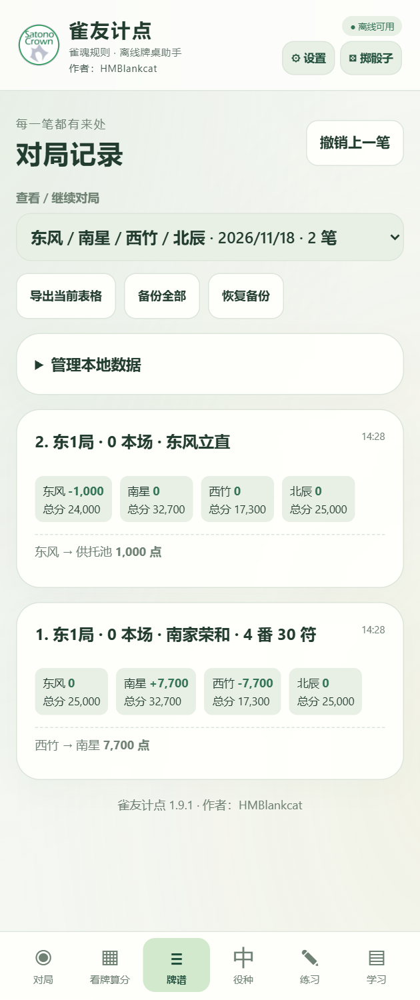</td>
    <td>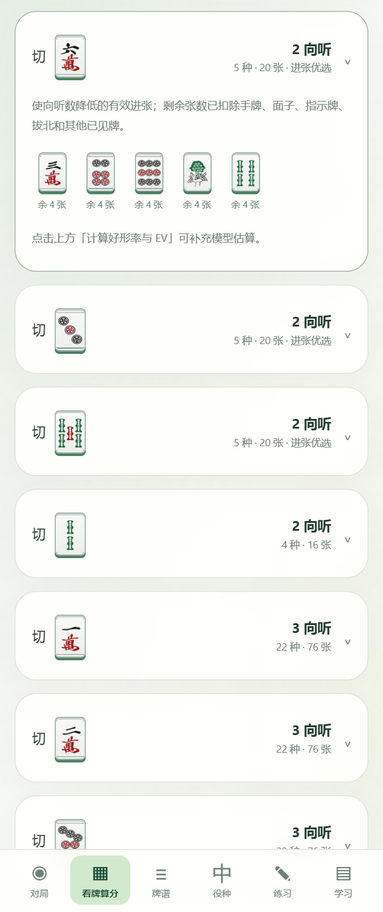</td>
    <td>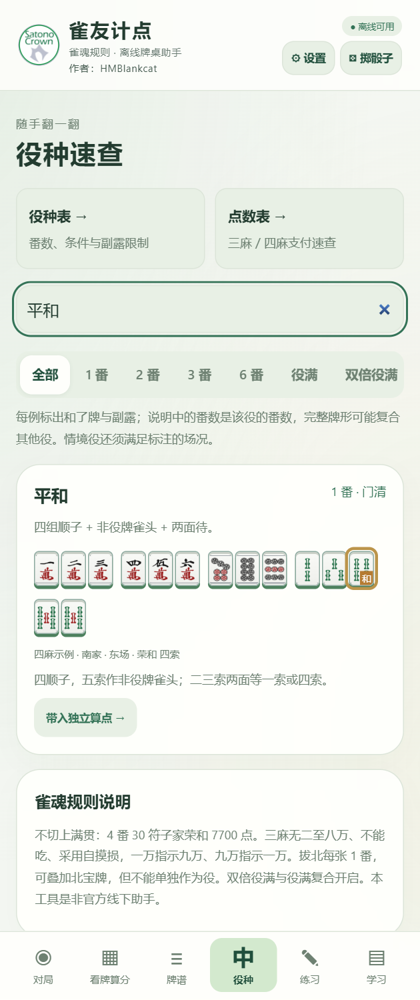</td>
  </tr>
  <tr>
    <th>给定手牌的点数练习</th><th>何切练习</th><th>清一色多面听</th>
  </tr>
  <tr>
    <td>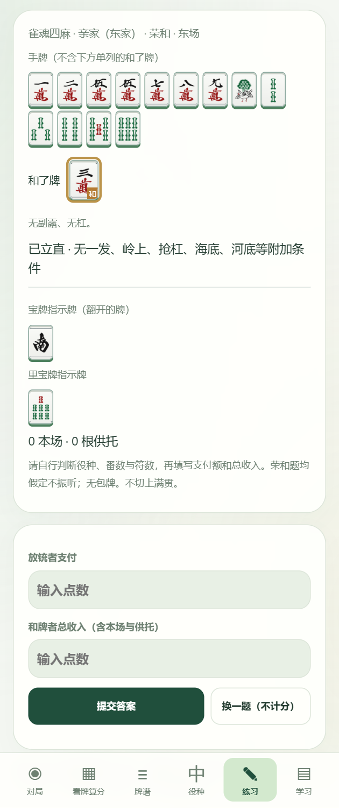</td>
    <td>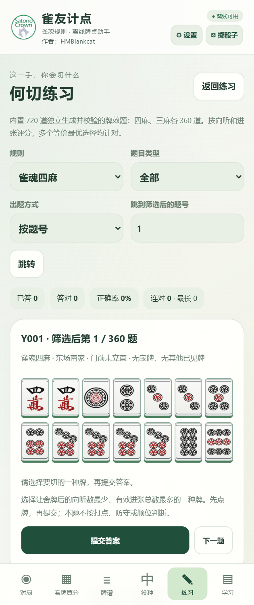</td>
    <td>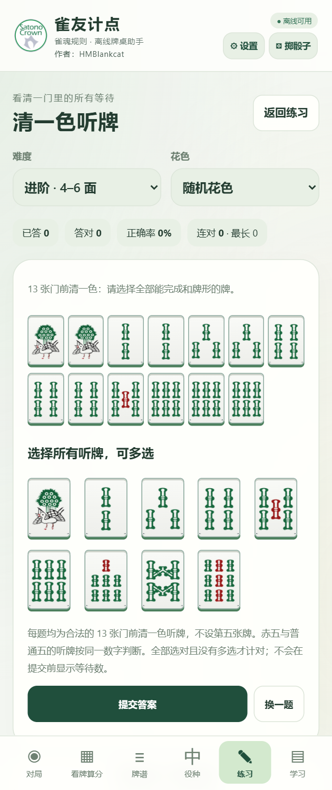</td>
  </tr>
  <tr>
    <th>离线学习书架</th><th>图文教程阅读</th><th>主题与外观设置</th>
  </tr>
  <tr>
    <td></td>
    <td>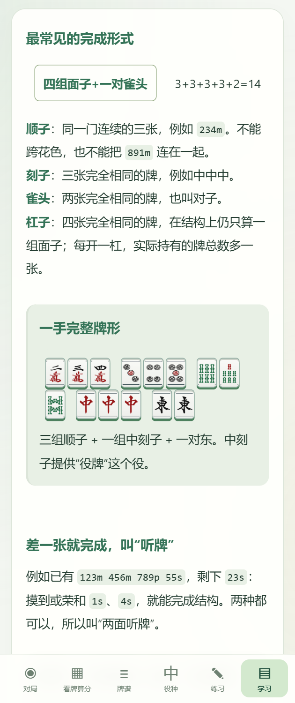</td>
    <td>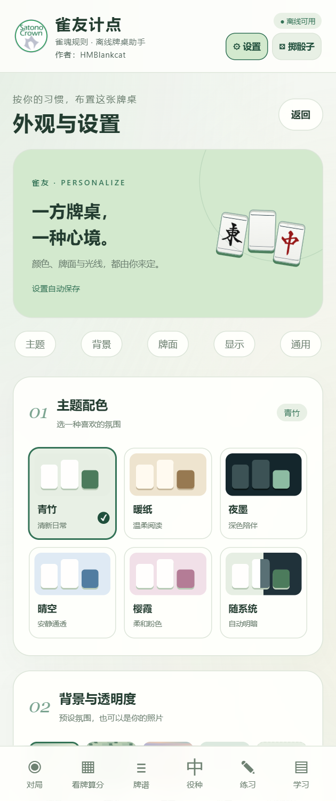</td>
  </tr>
</table>

<details>
<summary>查看夜墨主题</summary>
<p>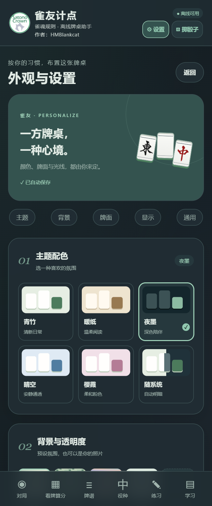</p>
</details>

## 下载与开始使用

1. 在 [Releases](https://github.com/HMBlankcat/Queyou/releases/latest) 下载 `Queyou-1.9.1.apk`，在 Android 8.0 及以上设备安装。首次安装时，按系统提示允许当前文件管理器或浏览器安装应用。
2. **只想算一手牌**：打开「看牌算分」，录入和牌后的暗牌，副露单独录入，再点选实际和了牌并设置和牌条件。宝牌栏填写的是**指示牌**。
3. **线下打牌记分**：在「对局」输入玩家，按初始东、南、西、北顺序排列；和牌后进入「和牌结算」，核对每位玩家的支付再入账。四麻默认每人 25000 点，三麻默认 35000 点，可自定义。
4. **日常学习**：从「学习」阅读教程，从「练习」进入点数、符数、何切或清一色训练。练习成绩与真实对局分别保存。

从之前的同签名版本升级时，**直接覆盖安装，不要先卸载**。卸载会清除本地数据，换机或清理前请先在「牌谱」中备份全部对局。CSV 用于查看，JSON 用于恢复；外观方案需在设置页单独导出。

## 规则与使用边界

- **四麻与三麻**：不启用切上满贯，4 番 30 符／3 番 60 符子家荣和均为 7700 点；支持累计役满、双倍役满和役满复合，连风雀头计 4 符。
- **三麻**：去二至八万、不能吃，一万与九万互为宝牌；采用自摸损。本场荣和另付 300 点，自摸每家另付 100 点。拔北每张加 1 番，可叠加北宝牌，但不能单独成役。
- **记账**：玩家余额合计加供托池应等于初始总点数。先登记实际立直支付，再结算和牌；算点中选择立直只用于判役，不会自动扣立直棒。
- **特殊结算**：多家和牌、包牌／责任支付、流局满贯和罚分请按现场规则手动转点。不会自动处理终局、延长战、马点或返还点结算。
- **合法性**：需要正确填写实际和了牌与和牌条件。App 不记录完整牌河，振听和特殊支付须由玩家自行核对；实际房间设置与教学题设可能不同。
- **牌效与 EV**：默认建议依据向听和进张。好形率与 EV 使用受限的计算模型，EV 为有限摸牌的自摸模拟估算，未完整模拟对手进攻、放铳风险或排名目标，适合比较与训练，不保证实战最优。
- **亮度与数据**：安装版亮度仅作用于当前 App 窗口；自选背景在本机压缩保存。清空全部本地数据会重置对局、算点输入、学习与练习记录、外观及背景；已导出的文件不受影响。

## 本地预览与开发

项目采用 HTML、CSS、JavaScript 与 Android WebView，应用功能不依赖在线服务。电脑预览建议通过本地 HTTP 服务打开，以便正常使用牌效计算的 Worker：

```sh
python -m http.server 8080
```

然后访问 <http://localhost:8080>。网页与 Android 安装版的本地记录相互独立。

核心与内容回归测试：

```sh
node --test tests/*.test.js
```

Android 构建入口为 [`android/build.ps1`](android/build.ps1)，需要 JDK 17、Android Build Tools 和平台 `android.jar`；签名密码通过 `QUEYOU_KEY_PASSWORD` 环境变量提供。签名密钥和密码文件不会纳入仓库。教材导入与界面整理工具位于 `tools/`，使用说明和内容校验记录位于 `docs/`。

## 作者与许可

作者：**HMBlankcat**。项目许可见 [LICENSE](LICENSE)，随附材料的许可文件及原始存档保留在 `docs/` 中。
